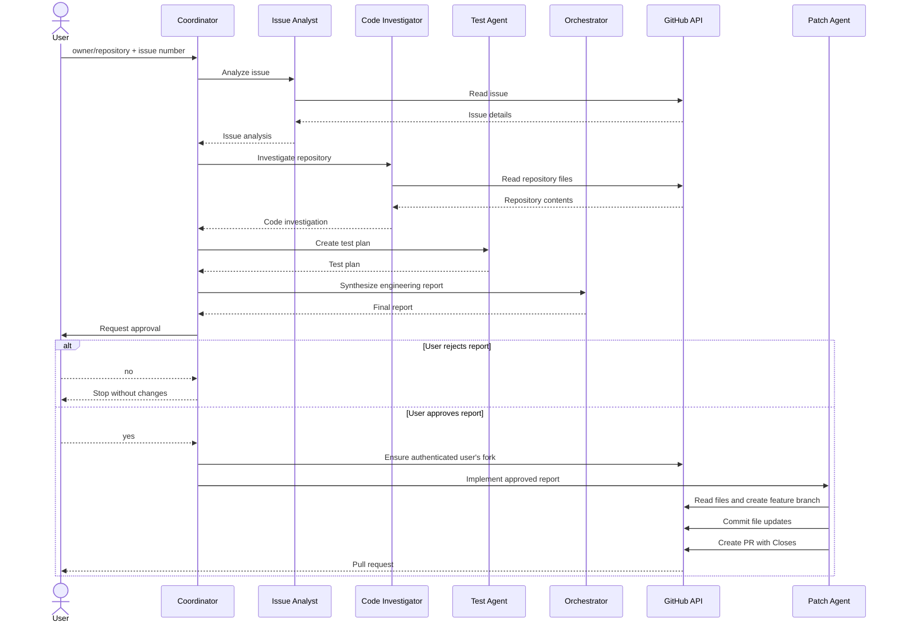

# GitHub Issue-to-PR Multi-Agent System

This multi-agent system accepts a GitHub issue, coordinates specialized agents to understand and investigate it, creates an implementation report for human confirmation, and—after approval—uses a fork and feature branch to prepare a pull request.

## Multi-Agent Architecture

The system is coordinated by [`src/index.ts`](./src/index.ts). Each agent has a focused responsibility and passes its output to the next agent:

1. **Issue Analyst** (`src/agents/issue-analyst.ts`)
   - Reads the issue through the GitHub API.
   - Summarizes the issue, affected area, acceptance criteria, and missing information.
2. **Code Investigator** (`src/agents/code-investigator.ts`)
   - Inspects the repository using `readRepositoryFile`.
   - Identifies relevant files, current behavior, root cause, and existing tests.
3. **Test Agent** (`src/agents/test-agent.ts`)
   - Produces a repository-specific test plan from the issue analysis and investigation.
4. **Orchestrator** (`src/agents/orchestrator.ts`)
   - Combines the previous outputs into a seven-section engineering report.
5. **User approval**
   - The report is displayed and the user chooses whether to continue.
6. **Patch Agent** (`src/agents/patch-agent.ts`)
   - Runs only after approval.
   - Reads source files, creates an issue-specific branch in the authenticated user’s fork, updates files, and creates a PR against the upstream repository.

GitHub operations are implemented in `src/tools/`, including issue lookup, repository reading, fork creation, branch creation, file updates, and pull request creation.

### Interaction flow



## Requirements

- Node.js 20 or newer
- A Google Gemini API key
- A GitHub token with permission to:
  - Read issues and repository contents
  - Create or access forks
  - Create branches and repository contents
  - Create pull requests

## Setup the Multi-Agent System

Install dependencies:

```bash
npm install
```

Create a `.env` file in the project root:

```env
GEMINI_API_KEY=your-gemini-api-key
GITHUB_TOKEN=your-github-token

# Optional model overrides
GEMINI_MODEL=gemini-2.5-flash
GEMINI_STRONG_MODEL=gemini-2.5-flash
```

Do not commit `.env` or expose either token. If a credential is exposed, revoke and rotate it immediately.

Build the project:

```bash
npm run build
```

## Run

Provide the upstream repository and issue number:

```bash
npm run dev -- owner/repository issue-number
```

Example:

```bash
npm run dev -- apsinghdev/opensox 440
```

The coordinator prints the issue analysis, code investigation, test plan, and final engineering report. Enter `no` to stop after the report without making repository changes. Enter `yes` only when you are ready to allow fork, branch, commit, and pull request operations.

The resulting PR is created from:

```text
authenticated-user:feature-branch
```

to the upstream repository’s detected default branch and includes `Closes #<issue-number>` in its body.

## Testing and troubleshooting

There is currently no automated test suite. Run the TypeScript validation with:

```bash
npm run build
```

For a safe end-to-end check, first run against a test repository and answer `no` at the approval prompt. Gemini free-tier quotas apply to the Google project, not just individual API keys; repeated agent/tool steps can consume the quota quickly. If quota errors occur, wait for the reset, use a project with sufficient quota, or configure an available lower-cost model.
