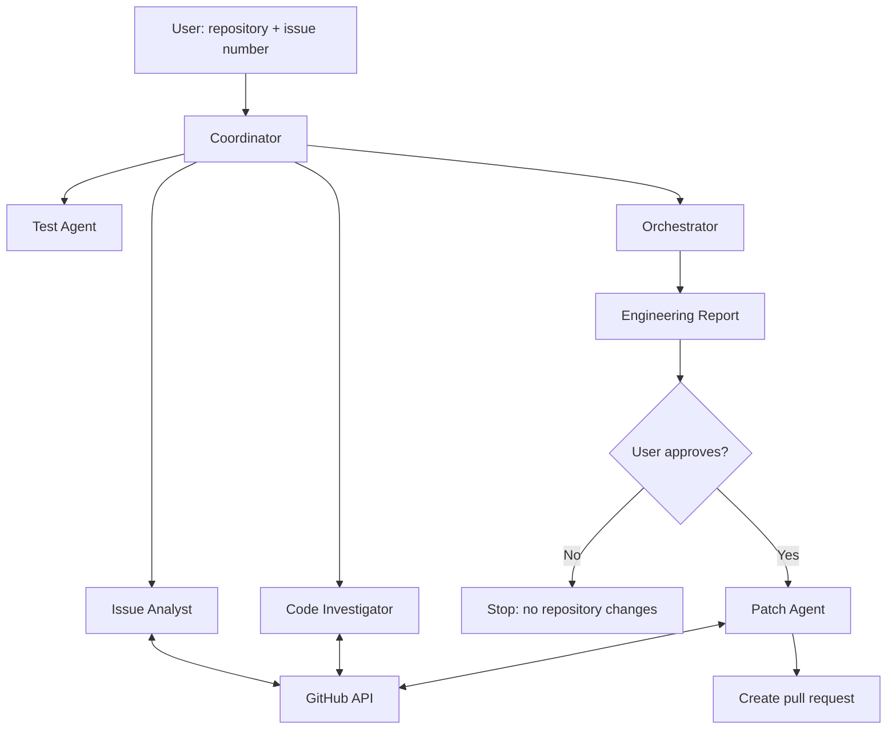

# GitHub Issue-to-PR Multi-Agent System

A TypeScript multi-agent system that analyzes a GitHub issue, investigates the codebase, creates a test plan, and prepares an implementation report. It can create a branch and pull request **only after you approve the report**.

## Architecture



- **Issue Analyst:** Summarizes the issue and acceptance criteria.
- **Code Investigator:** Finds relevant files and likely causes.
- **Test Agent:** Suggests tests.
- **Orchestrator:** Produces the engineering report.
- **Patch Agent:** Implements the approved plan and opens a pull request.

## Requirements

- Node.js 20+
- Google Gemini API key
- GitHub token with access to read issues and repository contents, create forks/branches, update files, and open pull requests.

## Setup

```bash
git clone https://github.com/KrishCodesw/multi-agent.git
cd multi-agent
npm install
```

Create a `.env` file in the project root:

```env
GEMINI_API_KEY=your-gemini-api-key
GITHUB_TOKEN=your-github-token
GEMINI_MODEL=gemini-2.5-flash
GEMINI_STRONG_MODEL=gemini-2.5-flash
```

Keep `.env` private. Do not commit API keys or tokens.

## Usage

Run the agent with a repository and issue number:

```bash
npm run dev -- owner/repository issue-number
```

Example:

```bash
npm run dev -- apsinghdev/opensox 440
```

Review the generated report. Enter `no` to stop without changes. Enter `yes` to allow the system to create a branch, commit changes, and open a pull request.

To check TypeScript compilation:

```bash
npm run build
```

> The project does not currently include an automated test suite.
